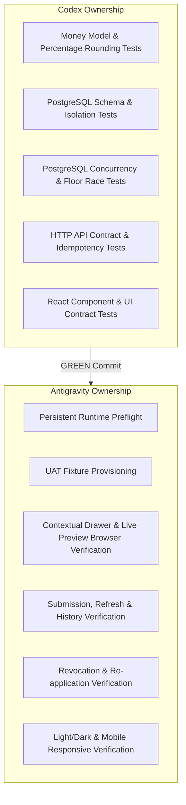

# FINANCE-F6-01 — Institutional Discount Policy & Contextual Obligation Concession v1 Design

## 1. Status / Authority

- **Status:** SPECIFICATION — NOT IMPLEMENTATION AUTHORITY.
- **Governing Architecture:** Nexus Finance Core Constitution (`docs/finance/FINANCE_FOUNDATION_PREPARATION.md`, F0-D01 to F0-D10), Nexus Master Plan v2 (`docs/product/NEXUS_MASTER_PLAN_V2.md`), and Engineering Playbook (`docs/operations/ENGINEERING_PLAYBOOK.md`).
- **Preceding Baseline:** Finance Foundation (Tasks 1–8), F1 Fee Catalogue, F2 Financial Account & Obligation, F3 Payment Core, F4 Allocation, and F5 Obligation Adjustment & UX V2 (integrated and verified at commit `06d04d5e77251db653c597c5bba0ae6c55537a87`).
- **Implementation Gate:** Implementation is **strictly blocked** until Product Owner approval of this specification.

---

## 2. Product Outcome

An authorized `financial` or `institution_admin` operator can define institutional Discount Policies (percentage rate or fixed amount) and apply an authorized policy concession to any open, eligible Financial Obligation within the authenticated institution.

Key user-facing outcomes:
1. **Governed Institutional Concessions:** Schools eliminate ad-hoc, untracked price reductions by enforcing versioned, auditable institutional Discount Policies (e.g. *Bolsa de Mérito 20%*, *Desconto de Irmãos 10%*, *Pronto Pagamento 25 EUR*).
2. **Contextual Financial Account Experience:** Concessions are applied and revoked directly from the Financial Account operational workspace through a dedicated contextual drawer (`Cobrança → ... → Aplicar desconto`), maintaining full visibility of the account in the background.
3. **Immutable History & Economic Integrity:** The original Obligation amount remains immutable. Concessions produce distinct, append-only financial facts in the authoritative Financial Journal, update derived balance projections instantly, respect the covered floor (concessions cannot reduce effective debt below what is already paid/covered), and support auditable total revocation.

---

## 3. Economic Semantics

### The Fundamental Distinction: Discount vs Adjustment

| Dimension | Adjustment (F5) | Discount (F6) |
| :--- | :--- | :--- |
| **Economic Meaning** | **Correction of error/defect:** An administrative fix for clerical errors, wrong price items, or contested invoice amounts. | **Policy-governed concession/entitlement:** An authorized reduction granted under defined institutional policies (scholarship, family, merit, prompt payment). |
| **Origin & Nature** | Ad-hoc or reasoned correction targeting a specific mistake. | Standardized institutional policy entitlement. |
| **Direction** | Bidirectional (`increase` or `decrease`). | Strictly **reduction** of payable obligation debt. |
| **Reference Authority** | Justification reason + optional compensation link to prior Adjustment. | Versioned institutional Discount Policy (`finance_discount_policies`). |
| **Journal Position** | `obligation_due_increased` / `obligation_due_decreased` | `obligation_discount_applied` / `obligation_discount_revoked` |

**Normative Rule:** Discount is **never** an alias or UI re-skin of Adjustment. They represent separate economic authorities, separate Journal positions, and separate analytical streams in institutional reporting.

---

## 4. Explicit Non-Goals (Out of Scope for F6 v1)

The following capabilities are strictly out of scope for F6 v1:
- **Automatic rule engines:** Automated demographic, academic merit, or sibling relationship evaluation engines.
- **Multiple discount stacking / compounding:** Compounding multiple discounts on a single obligation (e.g., 10% sibling + 5% early payment).
- **Partial revocation:** Revoking only a portion of an applied discount fact.
- **Penalty policy:** Late payment surcharges or interest calculations (reserved for F7).
- **Credit balances / credit notes:** Customer deposit credits or overpayment hold accounts (reserved for F8).
- **Cash refunds / disbursements:** Outgoing cash returns to payers (reserved for F9).
- **Bank reconciliation & external payment rails:** Provider transaction matching or automated bank statement feeds.
- **Autonomous AI execution:** AI models independently approving or applying financial concessions without human operator execution.
- **Cross-currency multi-FX recalculation:** Foreign exchange gain/loss accounting across differing currencies.

---

## 5. Existing Authorities Consumed

F6 consumes and builds upon the following frozen, verified capabilities without modification:
1. **Money Authority (`src/modules/finance/money.ts`, `exact-decimal.ts`):** Exact 12-decimal integer fixed-point arithmetic, currency isolation, deterministic rounding (`round_half_up`), and serialized Money envelopes (`{ amount: string, currency: string }`).
2. **Journal Authority (`src/modules/finance/journal-repository.ts`, `journal-model.ts`):** Authoritative double-entry-ready subledger transactions with composite tenant isolation and atomic commit semantics.
3. **Financial Account & Obligation Authority (`src/modules/finance/financial-account-repository.ts`, `financial-obligation-repository.ts`):** Tenant-scoped accounts, primary debtor person binding, obligation issuance, and lifecycle tracking.
4. **Allocation & Reversal Authority (`src/modules/finance/allocation-repository.ts`):** Payment settlement against obligations, locked concurrency control, and allocation reversals.
5. **Adjustment Authority (`src/modules/finance/obligation-adjustment-repository.ts`):** Compensating billing corrections and root compensation linkages.
6. **Institutional Context & Multi-Tenant Middleware (`src/auth/institutional-context.ts`, `src/middleware/multi-tenant.ts`):** Fail-closed server-authoritative institutional scope.

---

## 6. Discount Policy Model

Discount policies are institution-scoped catalog entities defining the terms under which a financial concession may be applied.

### Domain Model (`DiscountPolicy`)

```typescript
export type DiscountCalculationMode = 'percentage' | 'fixed_amount';
export type DiscountPolicyStatus = 'active' | 'archived';

export interface DiscountPolicy {
  readonly id: string;
  readonly institutionId: string;
  readonly code: string;
  readonly name: string;
  readonly description: string | null;
  readonly calculationMode: DiscountCalculationMode;
  readonly value: string; // e.g. "20.00" for 20%, or "25.00" for 25.00 EUR
  readonly currency: string | null; // Required when calculationMode === 'fixed_amount', null for percentage
  readonly status: DiscountPolicyStatus;
  readonly effectiveFrom: Date | null;
  readonly effectiveTo: Date | null;
  readonly version: number;
  readonly createdAt: Date;
  readonly updatedAt: Date;
}
```

### Policy Invariants
1. **Code Uniqueness:** `code` must be unique per institution among active policies (e.g. `BOLSA-20`, `IRMAOS-10`, `PRONTO-PAG`).
2. **Calculation Mode Validation:**
   - If `calculationMode === 'percentage'`: `value` must parse to an exact decimal in range `(0.00, 100.00]`. `currency` must be `NULL`.
   - If `calculationMode === 'fixed_amount'`: `value` must parse to a strictly positive exact decimal (`> 0.00`). `currency` must be a valid ISO 4217 code.
3. **Effective Interval:** If both `effectiveFrom` and `effectiveTo` are defined, `effectiveFrom <= effectiveTo`.
4. **V1 Eligibility Boundary:** An obligation is eligible for a policy if:
   - Policy `status === 'active'`;
   - Current date is within `[effectiveFrom, effectiveTo]` (if dates are specified);
   - If `fixed_amount`, policy `currency === obligation.currency`;
   - Obligation `status === 'open'`;
   - Obligation currently has **zero** active discounts.

---

## 7. Policy Versioning

To preserve historical auditability and deterministic reproduction of past financial positions:
1. **Immutable Snapshot on Application:** When a discount is applied, the calculated Money amount, percentage rate / fixed value, policy code, and policy version are permanently captured in the `finance_obligation_discounts` fact row.
2. **Policy Mutation Semantics:**
   - Modifying a policy's economic terms (`calculationMode`, `value`, or `currency`) increments `version` and preserves prior version metadata.
   - Archiving a policy (`status = 'archived'`) prevents *new* applications of that policy but **never** mutates, invalidates, or recalculates historically applied discounts.

---

## 8. Applied Discount Fact

An applied discount is an immutable economic fact recording an authorized reduction of an open obligation.

### Domain Model (`ObligationDiscount`)

```typescript
export interface ObligationDiscount {
  readonly id: string;
  readonly institutionId: string;
  readonly financialAccountId: string;
  readonly obligationId: string;
  readonly discountPolicyId: string;
  readonly policyCode: string;
  readonly policyName: string;
  readonly policyVersion: number;
  readonly calculationMode: DiscountCalculationMode;
  readonly policyValue: string; // Rate (e.g. "20.00") or Fixed amount ("25.00")
  readonly amount: Money; // Authoritative calculated discount Money amount
  readonly currency: string;
  readonly reason: string;
  readonly status: 'applied' | 'revoked';
  readonly journalTransactionId: string;
  readonly appliedAt: Date;
  readonly actorPersonId: string | null;
}
```

### Application Invariants
1. **At Most One Active Discount:** An obligation may have at most one discount in `status === 'applied'`.
2. **Floor Constraint:** An applied discount cannot cause the obligation's `effectiveDue` to drop below its `netCovered` amount (`effectiveDue >= netCovered`).
3. **Idempotency:** Every apply command carries a mandatory `Idempotency-Key` and canonical fingerprint. Replaying the exact command returns the existing record; sending a differing payload with the same key returns a `409 Conflict`.

---

## 9. Discount Revocation Fact

Revocation is an explicit, full cancellation of an active discount fact.

### Domain Model (`ObligationDiscountRevocation`)

```typescript
export interface ObligationDiscountRevocation {
  readonly id: string;
  readonly institutionId: string;
  readonly financialAccountId: string;
  readonly obligationId: string;
  readonly originalDiscountId: string;
  readonly amount: Money; // Exactly matches originalDiscount.amount
  readonly currency: string;
  readonly reason: string; // Mandatory non-empty operator justification
  readonly journalTransactionId: string;
  readonly revokedAt: Date;
  readonly actorPersonId: string | null;
}
```

### Revocation Invariants
1. **Total Revocation Only:** Revocation always cancels `100%` of the target discount's amount. Partial revocation is forbidden.
2. **Target Eligibility:** Target discount must exist in the same institution, match the specified obligation, and have `status === 'applied'`. A revoked discount cannot be revoked again.
3. **State Transition:** Upon revocation, a new `finance_obligation_discount_revocations` row is created, the original discount record's derived status becomes `'revoked'`, a compensating Journal entry is posted, and the obligation's payable balance is restored.
4. **Subsequent Concessions:** Once an active discount is revoked, the obligation has 0 active discounts and becomes eligible for a new discount application under an active policy if desired.

---

## 10. Money & Percentage Calculation

All calculations are strictly server-authoritative and executed using canonical `Money` exact decimal arithmetic.

### 10.1 Percentage Calculation Base

**Normative Invariant:** The percentage calculation base is the **pre-discount effective obligation value** at the instant of application:

$$\text{PreDiscountDue} = \text{OriginalObligationMoney} + \text{NetAdjustments}$$

Where:
- $\text{NetAdjustments} = \sum(\text{Adjustment increases}) - \sum(\text{Adjustment decreases})$

$$\text{CalculatedDiscountAmount} = \text{Quantize}\left(\text{PreDiscountDue} \times \frac{\text{PercentageRate}}{100},\; \text{CurrencyScale},\; \text{round\_half\_up}\right)$$

### 10.2 Interaction with Subsequent Adjustments (Snapshot Immutability)
- When a 20% discount is applied to an obligation with pre-discount due of $100.00\text{ EUR}$, an immutable discount fact of $20.00\text{ EUR}$ is recorded.
- If an administrative adjustment is later posted (e.g. $+10.00\text{ EUR}$ due to extra lab fee), the historical discount fact **remains exactly $20.00\text{ EUR}$**.
- It is **never** retroactively recalculated. If the operator wishes to adjust the concession, they must explicitly revoke the old discount and apply a new one.

### 10.3 Fixed Amount Calculation
- For fixed amount policies, $\text{CalculatedDiscountAmount} = \text{PolicyFixedMoney}$.
- If $\text{PolicyFixedMoney} > (\text{effectiveDue} - \text{netCovered})$, the application is **strictly rejected** with a floor violation error (`422/409`). It is never silently clamped.

---

## 11. Derived Obligation Financial Position

The server maintains **one unified, canonical derived position calculation** for an obligation across all financial operations (Adjustments, Discounts, Allocations, Reversals).

### Canonical Formula

```typescript
export interface ObligationFinancialPositionInput {
  readonly original: Money;
  readonly adjustments: readonly { readonly direction: 'increase' | 'decrease'; readonly amount: Money }[];
  readonly discounts: readonly { readonly status: 'applied' | 'revoked'; readonly amount: Money }[];
  readonly allocations: readonly Money[];
  readonly allocationReversals: readonly Money[];
}

export interface ObligationFinancialPosition {
  readonly netAdjustments: Money;
  readonly netDiscounts: Money;
  readonly effectiveDue: Money;
  readonly netCovered: Money;
  readonly remainingCoverable: Money;
}
```

$$\text{netAdjustments} = \sum \text{adjustment increases} - \sum \text{adjustment decreases}$$

$$\text{netDiscounts} = \sum_{\text{status}=\text{'applied'}} \text{discount.amount}$$

$$\text{effectiveDue} = \text{original} + \text{netAdjustments} - \text{netDiscounts}$$

$$\text{netCovered} = \sum \text{allocations} - \sum \text{allocationReversals}$$

$$\text{remainingCoverable} = \text{effectiveDue} - \text{netCovered}$$

### Mandatory Invariants Enforced by Position Engine
1. $\text{effectiveDue} \ge \text{netCovered}$
2. $\text{remainingCoverable} \ge 0.00$
3. Currency match across all components.

---

## 12. Journal Semantics

The typed Financial Journal is extended to incorporate discount transactions as distinct economic subledger movements.

### Typed Journal Extension

```typescript
// Transaction Type Extension
export type DiscountJournalType = 'obligation_discount';
export type JournalTransactionType = 
  | FoundationJournalType 
  | AllocationJournalType 
  | ObligationAdjustmentJournalType 
  | DiscountJournalType;

// Position Type Extension
export type DiscountPositionType = 
  | 'obligation_discount_applied' 
  | 'obligation_discount_revoked';

export type JournalPositionType = 
  | FoundationPositionType 
  | AllocationPositionType 
  | ObligationAdjustmentPositionType 
  | DiscountPositionType;
```

### Journal Booking Rules
1. **Discount Application:**
   - `journalType`: `'obligation_discount'`
   - Entry: `{ positionType: 'obligation_discount_applied', money: discountAmount, sourceRef: obligationId }`
   - `reason`: Operator-provided justification
   - `actorPersonId`: Authenticated actor
2. **Discount Revocation:**
   - `journalType`: `'obligation_discount'`
   - Entry: `{ positionType: 'obligation_discount_revoked', money: discountAmount, sourceRef: obligationId }`
   - `reason`: Operator-provided revocation justification
   - Links explicitly to the original discount ID in entry metadata.

---

## 13. Persistence & Tenant Isolation

All persistence enforces strict multi-tenant composite foreign keys and PostgreSQL check constraints.

### Schema Blueprint (`src/db/schema.ts`)

```sql
-- 1. Institutional Discount Policies
CREATE TABLE finance_discount_policies (
  id UUID PRIMARY KEY DEFAULT gen_random_uuid(),
  institution_id UUID NOT NULL REFERENCES institutions(id) ON DELETE RESTRICT,
  code VARCHAR(64) NOT NULL,
  name VARCHAR(255) NOT NULL,
  description TEXT,
  calculation_mode VARCHAR(32) NOT NULL CHECK (calculation_mode IN ('percentage', 'fixed_amount')),
  value NUMERIC(30, 12) NOT NULL CHECK (value > 0),
  currency VARCHAR(3) CHECK (currency IS NULL OR length(currency) = 3),
  status VARCHAR(32) NOT NULL DEFAULT 'active' CHECK (status IN ('active', 'archived')),
  effective_from TIMESTAMPTZ,
  effective_to TIMESTAMPTZ,
  version INTEGER NOT NULL DEFAULT 1,
  created_at TIMESTAMPTZ NOT NULL DEFAULT clock_timestamp(),
  updated_at TIMESTAMPTZ NOT NULL DEFAULT clock_timestamp(),
  CONSTRAINT uq_finance_discount_policies_code UNIQUE (institution_id, code),
  CONSTRAINT chk_discount_policy_mode_currency CHECK (
    (calculation_mode = 'percentage' AND currency IS NULL AND value <= 100) OR
    (calculation_mode = 'fixed_amount' AND currency IS NOT NULL)
  )
);

-- 2. Obligation Applied Discounts
CREATE TABLE finance_obligation_discounts (
  id UUID PRIMARY KEY DEFAULT gen_random_uuid(),
  institution_id UUID NOT NULL REFERENCES institutions(id) ON DELETE RESTRICT,
  financial_account_id UUID NOT NULL,
  obligation_id UUID NOT NULL,
  discount_policy_id UUID NOT NULL REFERENCES finance_discount_policies(id) ON DELETE RESTRICT,
  policy_code VARCHAR(64) NOT NULL,
  policy_name VARCHAR(255) NOT NULL,
  policy_version INTEGER NOT NULL,
  calculation_mode VARCHAR(32) NOT NULL CHECK (calculation_mode IN ('percentage', 'fixed_amount')),
  policy_value NUMERIC(30, 12) NOT NULL,
  amount NUMERIC(30, 12) NOT NULL CHECK (amount > 0),
  currency VARCHAR(3) NOT NULL,
  reason VARCHAR(500) NOT NULL,
  status VARCHAR(32) NOT NULL DEFAULT 'applied' CHECK (status IN ('applied', 'revoked')),
  journal_transaction_id UUID NOT NULL REFERENCES finance_journal_transactions(id) ON DELETE RESTRICT,
  applied_at TIMESTAMPTZ NOT NULL DEFAULT clock_timestamp(),
  actor_kind VARCHAR(32) NOT NULL DEFAULT 'human',
  actor_person_id UUID,
  CONSTRAINT fk_obligation_discounts_account FOREIGN KEY (institution_id, financial_account_id)
    REFERENCES finance_financial_accounts(institution_id, id) ON DELETE RESTRICT,
  CONSTRAINT fk_obligation_discounts_obligation FOREIGN KEY (institution_id, obligation_id)
    REFERENCES finance_obligations(institution_id, id) ON DELETE RESTRICT
);

-- 3. Obligation Discount Revocations
CREATE TABLE finance_obligation_discount_revocations (
  id UUID PRIMARY KEY DEFAULT gen_random_uuid(),
  institution_id UUID NOT NULL REFERENCES institutions(id) ON DELETE RESTRICT,
  financial_account_id UUID NOT NULL,
  obligation_id UUID NOT NULL,
  original_discount_id UUID NOT NULL REFERENCES finance_obligation_discounts(id) ON DELETE RESTRICT,
  amount NUMERIC(30, 12) NOT NULL CHECK (amount > 0),
  currency VARCHAR(3) NOT NULL,
  reason VARCHAR(500) NOT NULL,
  journal_transaction_id UUID NOT NULL REFERENCES finance_journal_transactions(id) ON DELETE RESTRICT,
  revoked_at TIMESTAMPTZ NOT NULL DEFAULT clock_timestamp(),
  actor_kind VARCHAR(32) NOT NULL DEFAULT 'human',
  actor_person_id UUID,
  CONSTRAINT uq_discount_single_revocation UNIQUE (institution_id, original_discount_id),
  CONSTRAINT fk_discount_revocations_account FOREIGN KEY (institution_id, financial_account_id)
    REFERENCES finance_financial_accounts(institution_id, id) ON DELETE RESTRICT,
  CONSTRAINT fk_discount_revocations_obligation FOREIGN KEY (institution_id, obligation_id)
    REFERENCES finance_obligations(institution_id, id) ON DELETE RESTRICT
);

-- Performance Indexes
CREATE INDEX idx_discount_policies_tenant ON finance_discount_policies(institution_id, status);
CREATE INDEX idx_obligation_discounts_lookup ON finance_obligation_discounts(institution_id, obligation_id, status);
CREATE INDEX idx_obligation_discounts_account ON finance_obligation_discounts(institution_id, financial_account_id);
```

---

## 14. Authorization

Authorization follows existing Finance Core role laws:

| Role | Policy Management (Create/Archive) | Apply Discount to Obligation | Revoke Discount | Read / View Context |
| :--- | :---: | :---: | :---: | :---: |
| `institution_admin` | **ALLOWED** | **ALLOWED** | **ALLOWED** | **ALLOWED** |
| `financial` | **ALLOWED** | **ALLOWED** | **ALLOWED** | **ALLOWED** |
| `director` | *DENIED* (403) | *DENIED* (403) | *DENIED* (403) | **ALLOWED** |
| `secretariat` | *DENIED* (403) | *DENIED* (403) | *DENIED* (403) | *DENIED* (403) |
| `teacher` / `student` / `parent` | *DENIED* (403) | *DENIED* (403) | *DENIED* (403) | *DENIED* (403) |

---

## 15. Idempotency

All mutation operations execute through the canonical `executeIdempotentFinanceCommand` wrapper:
- **Operation Namespaces:**
  - `finance.discount.policy.create`
  - `finance.obligation.discount.apply`
  - `finance.obligation.discount.revoke`
- **Fingerprinting:** Canonical SHA-256 hash of `{ institutionId, operation, targetId, payload }`.
- **Replay Behavior:** Identical key + identical fingerprint returns `200 OK` with original payload (`replayed: true`).
- **Conflict Behavior:** Identical key + differing payload returns `409 Conflict` (`DISCOUNT_CONFLICT`).

---

## 16. Concurrency & Lock Order

To prevent deadlocks and race conditions against allocations, adjustments, and reversals, all write commands adhere to the **Universal Finance Lock Hierarchy**:

$$\begin{aligned}
\text{Step 1: } & \text{LOCK Financial Account (FOR UPDATE)} \\
\text{Step 2: } & \text{LOCK Obligation (FOR UPDATE)} \\
\text{Step 3: } & \text{LOCK Existing Allocations \& Reversals (FOR UPDATE)} \\
\text{Step 4: } & \text{LOCK Existing Adjustments (FOR UPDATE)} \\
\text{Step 5: } & \text{LOCK Existing Discounts \& Revocations (FOR UPDATE)} \\
\text{Step 6: } & \text{Re-derive Position \& Verify Floor Constraint Invariant} \\
\text{Step 7: } & \text{Insert Journal Entry \& Fact Record}
\end{aligned}$$

### Concurrency Matrix & Invariant Guarantees

| Concurrent Contenders | Execution Behavior | Invariant Guarantee |
| :--- | :--- | :--- |
| **Apply Discount × Apply Discount** | Serialized at Obligation lock. Second transaction sees active discount and fails with `409 ALREADY_DISCOUNTED`. | Maximum 1 active discount per obligation. |
| **Apply Discount × Allocate Payment** | Serialized at Account/Obligation lock. If Discount commits first, Allocation sees reduced `remainingCoverable`. If Allocation commits first, Discount verifies floor against new `netCovered`. | Covered floor never breached (`effectiveDue >= netCovered`). |
| **Apply Discount × Decrease Adjustment** | Serialized at lock. Cumulative reduction cannot exceed unallocated head space. | `remainingCoverable >= 0` always holds. |
| **Revoke Discount × Allocate Payment** | Serialized. Revocation increases `effectiveDue` and `remainingCoverable`, safely allowing subsequent allocations. | Deterministic capacity expansion without race corruption. |

---

## 17. HTTP Contracts

### 17.1 Policy Management Endpoints

#### `GET /api/finance/discount-policies`
- **Query Params:** `status=active|archived|all`
- **Response (200 OK):**
```json
{
  "policies": [
    {
      "id": "7b0a8806-031e-42c2-8414-b6d85915d311",
      "code": "BOLSA-20",
      "name": "Bolsa de Mérito 20%",
      "description": "Bolsa institucional de mérito académico",
      "calculationMode": "percentage",
      "value": "20.00",
      "currency": null,
      "status": "active",
      "effectiveFrom": "2026-09-01T00:00:00.000Z",
      "effectiveTo": "2027-08-31T23:59:59.999Z",
      "version": 1
    }
  ]
}
```

#### `POST /api/finance/discount-policies`
- **Headers:** `Idempotency-Key: <UUID>`
- **Request Body:**
```json
{
  "code": "BOLSA-20",
  "name": "Bolsa de Mérito 20%",
  "description": "Bolsa institucional de mérito académico",
  "calculationMode": "percentage",
  "value": "20.00",
  "currency": null,
  "effectiveFrom": "2026-09-01T00:00:00.000Z",
  "effectiveTo": "2027-08-31T23:59:59.999Z"
}
```
- **Response:** `201 Created`

#### `PATCH /api/finance/discount-policies/:id/archive`
- **Response:** `200 OK` (sets `status = 'archived'`)

---

### 17.2 Obligation Concession Endpoints

#### `POST /api/finance/obligations/:obligationId/discounts`
- **Headers:** `Idempotency-Key: <UUID>`
- **Request Body:**
```json
{
  "discountPolicyId": "7b0a8806-031e-42c2-8414-b6d85915d311",
  "reason": "Atribuição de Bolsa de Mérito conforme deliberação da Direção."
}
```
- **Response (201 Created / 200 Replayed):**
```json
{
  "discount": {
    "id": "e2c342f1-6119-482a-a70d-f203875a6c42",
    "obligationId": "00f609e9-98b3-4b22-aaeb-3b3d4d1363f8",
    "policyCode": "BOLSA-20",
    "policyName": "Bolsa de Mérito 20%",
    "calculationMode": "percentage",
    "policyValue": "20.00",
    "money": { "amount": "20.00", "currency": "EUR" },
    "reason": "Atribuição de Bolsa de Mérito conforme deliberação da Direção.",
    "status": "applied",
    "appliedAt": "2026-09-08T12:00:00.000Z"
  },
  "position": {
    "netAdjustments": { "amount": "0.00", "currency": "EUR" },
    "netDiscounts": { "amount": "20.00", "currency": "EUR" },
    "effectiveDue": { "amount": "80.00", "currency": "EUR" },
    "netCovered": { "amount": "40.00", "currency": "EUR" },
    "remainingCoverable": { "amount": "40.00", "currency": "EUR" }
  },
  "replayed": false
}
```

#### `POST /api/finance/obligations/:obligationId/discounts/:discountId/revoke`
- **Headers:** `Idempotency-Key: <UUID>`
- **Request Body:**
```json
{
  "reason": "Perda de elegibilidade por transferência de ciclo."
}
```
- **Response (200 OK / 200 Replayed):**
```json
{
  "revocation": {
    "id": "993a40b1-382a-43d8-a1bf-10499b9cf2a1",
    "originalDiscountId": "e2c342f1-6119-482a-a70d-f203875a6c42",
    "money": { "amount": "20.00", "currency": "EUR" },
    "reason": "Perda de elegibilidade por transferência de ciclo.",
    "revokedAt": "2026-09-08T12:30:00.000Z"
  },
  "position": {
    "netAdjustments": { "amount": "0.00", "currency": "EUR" },
    "netDiscounts": { "amount": "0.00", "currency": "EUR" },
    "effectiveDue": { "amount": "100.00", "currency": "EUR" },
    "netCovered": { "amount": "40.00", "currency": "EUR" },
    "remainingCoverable": { "amount": "60.00", "currency": "EUR" }
  },
  "replayed": false
}
```

---

## 18. Policy Management UX

Institutional discount policies are configured within the existing Finance workspace configuration sub-navigation:
- **Location:** `FinanceWorkspace` → Sub-tab `Catálogo de Emolumentos & Políticas` → Section `Políticas de Desconto`.
- **Presentation:** Compact table displaying Code, Name, Mode (Badge: `20%` or `25,00 EUR`), Status (`Ativa` / `Arquivada`), Validity Window, and Actions (`Arquivar`).
- **Creation Dialog / Modal:** Compact form with Code, Name, Description, Calculation Mode toggle (`Percentagem` vs `Valor Fixo`), Value input, Currency selector (active only if fixed), and optional Date Pickers.

---

## 19. Contextual Application / Revocation UX

Concession operations occur strictly within the contextual `FinanceOperationalContextWorkspace`.

### Contextual Entry Points
- **On Open Obligation with No Active Discount:**
  - `...` contextual menu on charge row contains item: **`Aplicar desconto institucional`**.
- **On Open Obligation with Active Discount:**
  - Charge row displays a subtle tonal badge: `Desconto: Bolsa de Mérito 20% (-20,00 EUR)`.
  - `...` contextual menu contains item: **`Revogar desconto`**.

### Application Drawer (`FinanceObligationDiscountDrawer`)
1. **Header:** `Aplicar desconto institucional` + Close button.
2. **Context Summary:** Charge description, Original Value, Current Effective Due, and Covered Amount.
3. **Policy Selection:** Clean dropdown / segmented selector listing eligible active policies with badges.
4. **Concession Preview (Antes → Desconto → Depois):**
   - *Valor atual devido:* `100,00 EUR`
   - *Desconto calculado:* `-20,00 EUR` (`Bolsa de Mérito 20%`)
   - *Novo valor a pagar:* `80,00 EUR`
   - *Já liquidado:* `40,00 EUR`
   - *Ficará por liquidar:* `40,00 EUR`
5. **Justification Input:** Mandatory textarea with suggested quick chips (`Bolsa autorizada`, `Desconto de irmãos`, `Protocolo institucional`).
6. **Floor Error Warning:** If fixed discount exceeds available debt, preview flags in rose tone: `O desconto não pode ser superior ao valor restante por liquidar (60,00 EUR)`. Confirmation button is disabled.
7. **Footer CTA:** `Cancelar` and `Confirmar desconto` (with loading spinner `A aplicar desconto...`).

---

## 20. Adaptive Nexus Boundaries

| Nexus May (Permitted Guidance) | Nexus May NOT (Forbidden Autonomous Action) |
| :--- | :--- |
| Filter and suggest eligible active policies matching obligation currency | Silently apply a discount without human operator submission |
| Pre-calculate and render real-time financial preview | Autonomously approve financial policy waivers |
| Highlight maximum discountable capacity before floor breach | Modify discount amounts independently of policy rules |
| Suggest standard human-readable justification reasons | Override covered-floor constraints |

---

## 21. Error Model

| Error Code | HTTP Status | Trigger Condition | Operator Facing Message |
| :--- | :---: | :--- | :--- |
| `DISCOUNT_UNAUTHORIZED` | 401 | Missing authentication token | Sessão expirada. Inicie sessão novamente. |
| `DISCOUNT_FORBIDDEN` | 403 | Non-authorized role (e.g. `director`, `secretariat`) | Não tem permissões para gerir descontos financeiros. |
| `DISCOUNT_NOT_FOUND` | 404 | Obligation or Policy ID does not exist in tenant | Obrigação ou política de desconto não encontrada. |
| `DISCOUNT_ALREADY_ACTIVE` | 409 | Obligation already has an active discount | Esta cobrança já possui um desconto ativo. Revogue-o antes de aplicar um novo. |
| `DISCOUNT_FLOOR_VIOLATION` | 422 | Discount amount would cause `effectiveDue < netCovered` | O desconto não pode reduzir o valor devido abaixo do montante já liquidado. |
| `DISCOUNT_INACTIVE_POLICY` | 422 | Selected policy is archived or outside validity window | A política de desconto selecionada não se encontra ativa. |
| `DISCOUNT_CURRENCY_MISMATCH` | 422 | Policy fixed currency != Obligation currency | A moeda da política de desconto não coincide com a cobrança. |
| `DISCOUNT_CONFLICT` | 409 | Idempotency key reused with different payload | Conflito de submissão na operação de desconto. |

---

## 22. Accessibility, Theme, Responsive & Motion

- **Accessibility (WCAG 2.1 AA):** Complete ARIA modal dialog markup (`role="dialog"`, `aria-modal="true"`, `aria-label`), keyboard focus trap, `Escape` key close, and focus restoration to the originating `...` trigger button.
- **Theme Support:** Dedicated Nexus Aurora tonal tokens for Light and Dark themes. Contrast ratio $\ge 4.5:1$ for all text elements.
- **Responsive Layout:** Full desktop side drawer geometry transitioning to full-width mobile view on narrow viewports ($<640\text{px}$) with zero horizontal scroll overflow.
- **Motion:** Subdued CSS microinteractions ($\le 150\text{ms}$) with `prefers-reduced-motion: reduce` fully disabling transitions.

---

## 23. UAT Fixture

Extended canonical fixture in `scripts/provision-local-finance-uat.ts`:

### Starting Baseline State
- **Account:** `UAT — Finance Discount 100-40-60`
- **Obligation:** `UAT-F6-DISCOUNT-100-40-60` (Tuition fee)
  - `Original`: `100.00 EUR`
  - `Covered`: `40.00 EUR` (Cash Payment `PAG-UAT-F6`)
  - `Effective Due`: `100.00 EUR`
  - `Remaining Coverable`: `60.00 EUR`
  - `Initial Discounts`: `0`
- **Pre-provisioned Policies:**
  1. `BOLSA-20`: `Bolsa de Mérito 20%` (`percentage`, `20.00%`)
  2. `IRMAOS-10`: `Desconto Irmãos 10 EUR` (`fixed_amount`, `10.00 EUR`)
  3. `GRANDE-70`: `Desconto Excedente 70 EUR` (`fixed_amount`, `70.00 EUR` — for floor rejection test)

---

## 24. Behavioral, PostgreSQL & Browser Proof Matrix



### 1. PostgreSQL & Concurrency Matrix (`tests/finance-discount-postgres.test.ts`)
- Tenant composite foreign key enforcement across foreign institutions.
- Multi-currency rejection.
- Concurrent Apply × Apply race condition (verifying exactly 1 winner, 1 `409`).
- Concurrent Apply × Allocate race condition (verifying floor constraint preserved under load).
- Replay idempotency (`200`) and conflict rejection (`409`).
- Atomic Journal rollback upon simulated constraint failure.

### 2. HTTP & Component Tests (`tests/finance-discount-http.test.ts`, `tests/finance-discount-ui.test.ts`)
- Policy creation and archival routes.
- Role-based authorization (`institution_admin` / `financial` write, `director` read-only).
- UI state transitions: policy selection, live calculated preview, reason entry, floor error handling.

### 3. Real Browser E2E Gate
- Execution against persistent test server on `http://localhost:3000`.
- Visual validation of drawer opening, account retention, percentage calculation display, submission, and instant operational history update.

---

## 25. Codex → Antigravity Handoff Contract

### Codex Implementation Scope (Writer 1)
- Write schema migration (`0040_finance_discount_policy_and_concessions.sql`).
- Implement domain models, policy repository, discount repository, and Journal extensions.
- Extend `deriveObligationFinancialPosition` in `obligation-financial-position.ts`.
- Implement HTTP routes, API client, and React UI components (`FinanceObligationDiscountDrawer`, `FinanceDiscountPoliciesView`).
- Deliver all deterministic test suites (unit, PostgreSQL, HTTP, UI contracts) in **GREEN** state.
- Commit to branch `codex/finance-f6-discount-policy-v1`.

### Antigravity Verification Scope (Writer 2)
- Inspect commit HEAD and run `npm run nexus:preflight`.
- Launch persistent test server and execute UAT fixture provisioning.
- Execute real browser test suite and capture WebP session recordings.
- Validate Light/Dark themes, responsive widths, keyboard focus, and reduced-motion states.
- Run complete quality matrix: `lint`, `build`, `git diff --check`, `test:secrets`, `test:artifacts`.
- Prepare final release evidence for Product Owner Human UAT.

---

## 26. Explicit File/Authority Boundaries

### Files Allowed for Creation / Modification in F6
- `src/db/schema.ts` (Add `finance_discount_policies`, `finance_obligation_discounts`, `finance_obligation_discount_revocations`)
- `src/db/migrations/0040_finance_discount_policy_and_concessions.sql`
- `src/modules/finance/discount-policy-model.ts` [NEW]
- `src/modules/finance/discount-policy-repository.ts` [NEW]
- `src/modules/finance/discount-policy-http.ts` [NEW]
- `src/modules/finance/obligation-discount-model.ts` [NEW]
- `src/modules/finance/obligation-discount-repository.ts` [NEW]
- `src/modules/finance/obligation-discount-http.ts` [NEW]
- `src/modules/finance/obligation-discount-client.ts` [NEW]
- `src/modules/finance/obligation-financial-position.ts` (Extend with discount position inputs)
- `src/modules/finance/journal-model.ts` (Add `obligation_discount` types)
- `src/modules/finance/finance-operational-context-repository.ts` (Include discount data in operational context query)
- `src/components/finance/operational/FinanceObligationDiscountDrawer.tsx` [NEW]
- `src/components/finance/operational/FinanceOperationalTruthPanels.tsx` (Add `...` action and discount badge)
- `src/components/finance/operational/FinanceOperationalHistory.tsx` (Render discount applied/revoked items)
- `src/components/finance/fee-catalogue/FinanceDiscountPoliciesWorkspace.tsx` [NEW]
- `scripts/provision-local-finance-uat.ts` (Extend with discount fixture)
- `tests/finance-discount-*.test.ts` [NEW]

---

## 27. Product Owner Decisions (D01 / D02 / D03)

- **D01 — Calculation Modes:** Approved. Supports `percentage` (exact half-up rounding against pre-discount due) and `fixed_amount` (exact Money in obligation currency).
- **D02 — Active Discount Multiplicity:** Approved. Maximum **one active discount** per obligation in v1. No stacking or compounding.
- **D03 — Revocation Semantics:** Approved. Total explicit revocation only, creating an immutable compensating fact, restoring payable balance, and enabling subsequent new concessions.

---

## 28. Acceptance Criteria

1. **Policy Management:** Financial admins can create, list, and archive percentage and fixed-amount discount policies.
2. **Contextual Concession:** Operators can apply an active discount policy to an open obligation from the Financial Account workspace with instant before/after preview.
3. **Floor Invariant:** System strictly blocks any discount that would reduce `effectiveDue` below `netCovered`.
4. **Total Revocation:** Active discounts can be revoked with a mandatory reason, immediately restoring the payable balance.
5. **Immutable Journal:** Every application and revocation generates an append-only Journal entry with source linkage.
6. **No Regressions:** All existing F1–F5 test suites pass with 0 errors.

---

## 29. Out-of-Scope Future Evolution

- **F7:** Late Payment Penalties & Interest Rules.
- **F8:** Customer Credit Balances & Advance Holds.
- **F9:** Cash Refunds & Disbursement Lifecycle.
- **F10:** External Payment Gateway & Bank Reconciliation.
